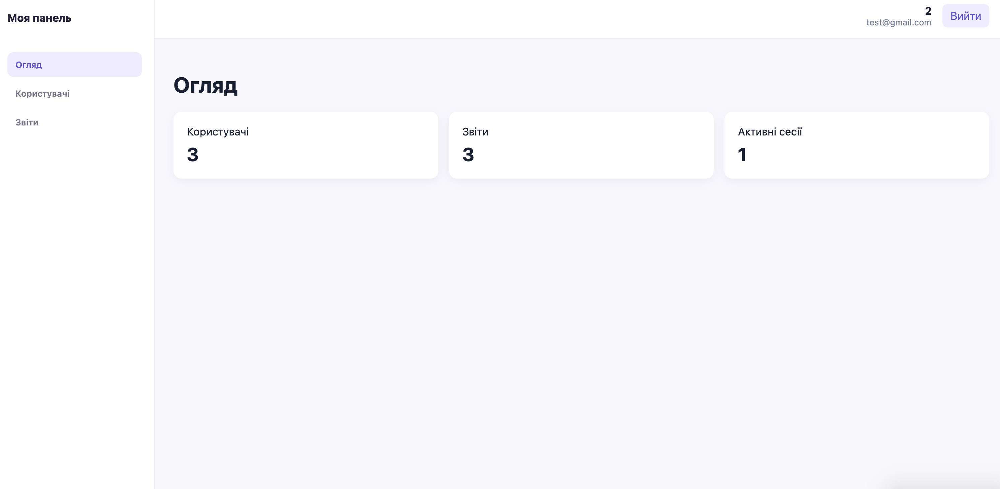
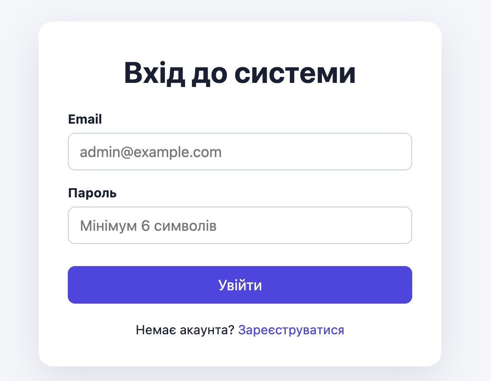
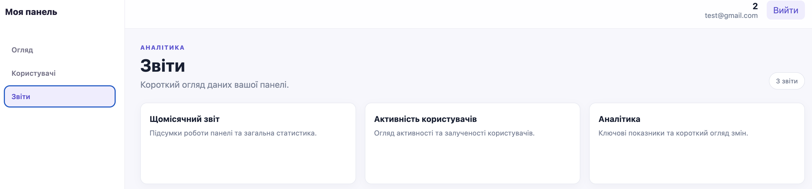
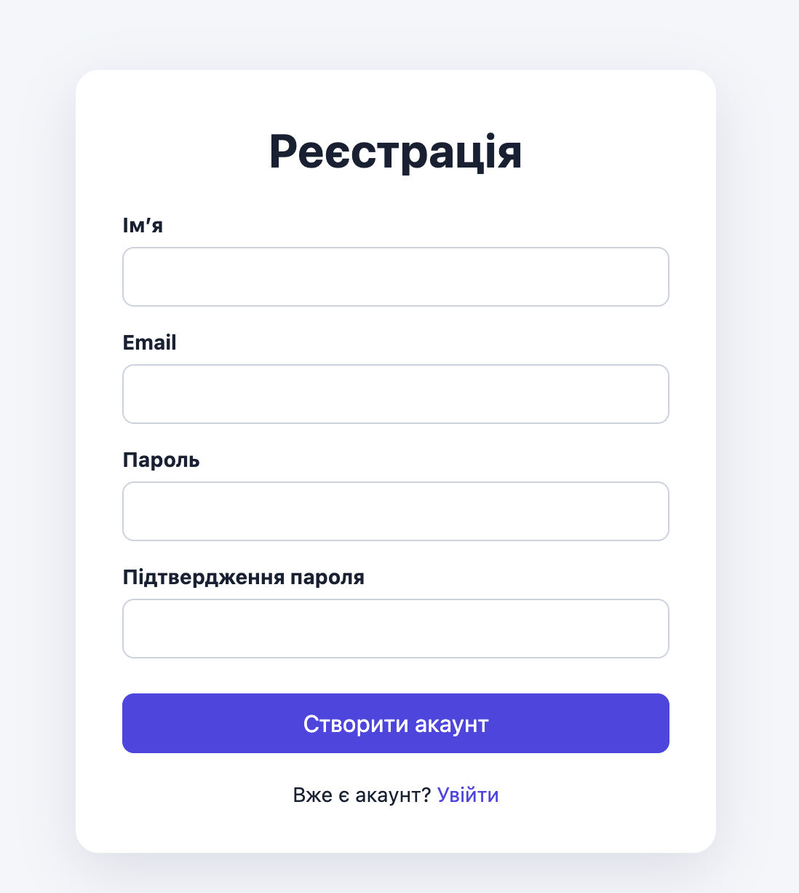

# Лабораторна робота №2 — Vue Admin

Прототип адмін-панелі на Vue 3, Vue Router 4 і Vite. Автентифікація імітується локально у браузері.

## Запуск

```bash
cd lab2
npm install
npm run dev
```

Для production-збірки:

```bash
npm run build
npm run preview
```

## Можливості

- `/` — стартова сторінка, `/login` і `/register` — форми входу та реєстрації.
- `/admin/dashboard`, `/admin/users`, `/admin/user/:id`, `/admin/reports` — захищені сторінки панелі.
- Невідомі адреси відкривають сторінку 404.
- Дані користувачів і звітів для демонстрації зберігаються локально; реального API немає.

## Де використані вимоги Vue

- **props:** `StatCard` отримує назву й значення картки через props.
- **emits:** `FormField` надсилає батьківській формі подію `blur`.
- **v-model / defineModel:** `FormField.vue` використовує `defineModel()` для значення поля та `v-model` у формах.
- **provide / inject:** `App.vue` передає реактивний стан автентифікації; сторінки входу, реєстрації та макет панелі отримують його через `inject`.
- **Слоти:** `AuthCard.vue` надає основний слот та іменовані `header` і `footer` для форм.
- **Роутинг:** `src/router/index.js` налаштовує `createWebHistory`, lazy-loaded сторінки, `scrollBehavior`, активний клас посилань, catch-all маршрут та `beforeEach` guard для `requiresAuth`.

## Скриншоти










