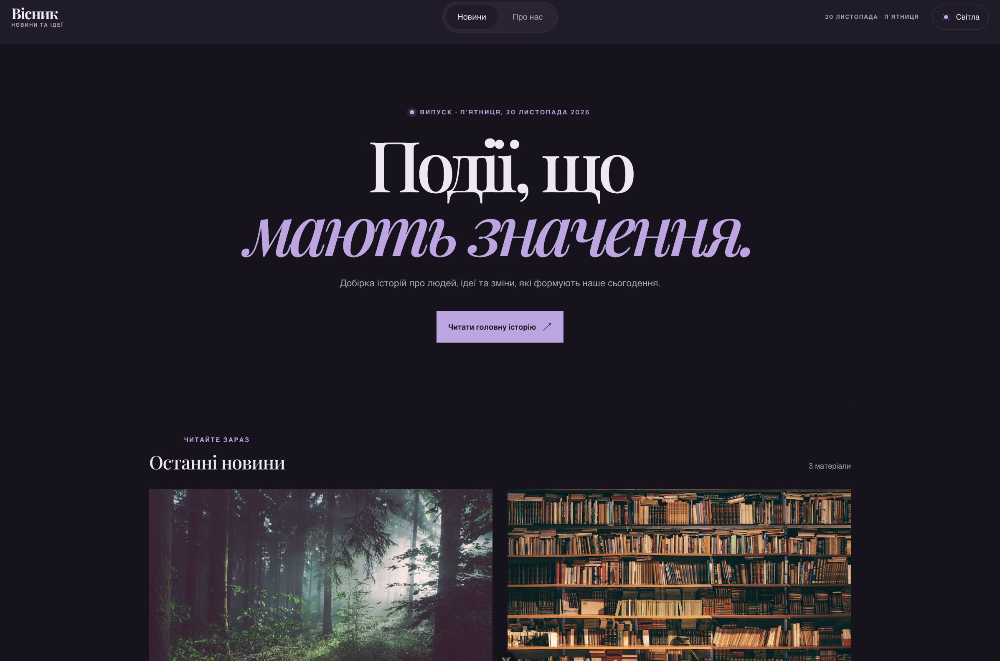
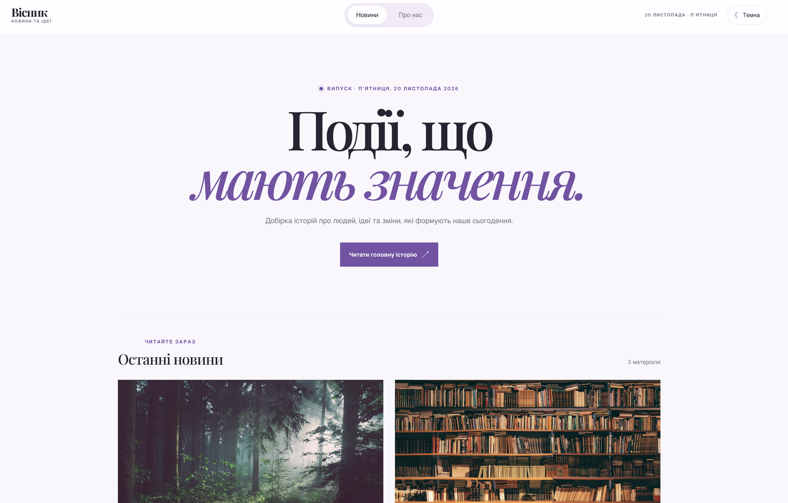

# Вісник — навчальний новинний сайт

Прототип новинного сайту для лабораторної роботи №3 зі стилізації компонентів у Vue.js. Дані статей зберігаються локально у `src/data/news.js`; сервер і база даних не потрібні.

## Запуск

```sh
npm install
npm run dev
```

Щоб зібрати production-версію:

```sh
npm run build
npm run preview
```

## Сторінки

- `/` — список новин.
- `/article/:id` — повний матеріал зі статтею.
- `/about` — інформація про редакцію.
- невідомий шлях — сторінка 404.

## Що реалізовано

- Vue 3 Composition API, Vue Router 4 і навігація через `createWebHistory`.
- Спільні хедер і футер; активний пункт меню та прокрутка угору після переходу.
- Новини з локального масиву, повторно використовувана картка новини.
- Два рекламні слоти. Натискання відкриває модальне вікно, яке закривається кнопкою, кліком поза вікном або клавішею Escape.
- Перемикач світлої та темної теми у хедері. Вибір зберігається в `localStorage`.
- CSS Modules у `NewsCard.vue` через файл `src/styles/NewsCard.module.css`; scoped-стилі — у сторінках та інших компонентах.
- Плавна анімація переходу між маршрутами й окрема анімація модального вікна.

## Стилізація у Vue.js

`<style scoped>` обмежує звичайні стилі компонентом, тому правила різних компонентів менше конфліктують. CSS Modules вирішує схожу задачу через локальні імена класів, які компонент отримує як об’єкт стилів. Глобальні CSS-змінні зручно використовувати для спільних кольорів і перемикання теми. Компонент `<Transition>` додає анімацію до появи й зникнення елементів, а для маршрутів він працює разом із `RouterView`.

## Скріншоти для звіту


