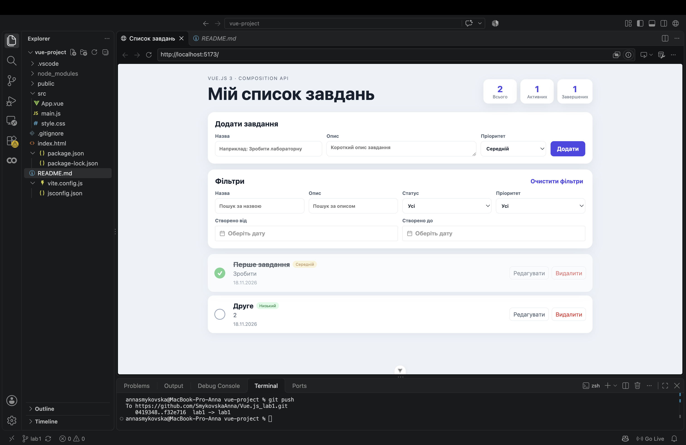

# Лабораторна робота №1 — Vue.js 3

Простий список завдань, створений за допомогою Vue 3 та Composition API.

## Запуск проєкту

Відкрийте термінал у папці проєкту та виконайте:

```bash
npm install
npm run dev
```

Vite покаже адресу локального сайту. Щоб створити production-збірку:

```bash
npm run build
```

## Можливості

- Додавання, редагування й видалення завдань.
- Перемикання статусу між активним і виконаним.
- Фільтри за назвою, описом, статусом, пріоритетом і датою.
- Збереження завдань у `localStorage`.
- Лічильники та пагінація по п'ять завдань.

## Реактивність у Vue

- `ref` зберігає список завдань, номер сторінки та стани форм.
- `reactive` зберігає поля форми та фільтрів.
- `computed` обчислює лічильники, відфільтрований список і сторінки.
- `watch` із `deep: true` зберігає зміни завдань у `localStorage`.

## Директиви

- `v-model` пов'язує поля форм і фільтрів зі станом.
- `@submit` та `@click` обробляють дії користувача.
- `:class`, `:disabled`, `:locale` та інші `v-bind` передають значення в атрибути компонентів.
- `v-for` відображає завдання та номери сторінок.
- `v-if` / `v-else` показують помилки, порожній список і форму редагування.
- `v-show` використовується для показу пагінації, коли є кілька сторінок.

Для календаря використано `@vuepic/vue-datepicker`; українську локаль надає `date-fns`.

## Скріншоти

